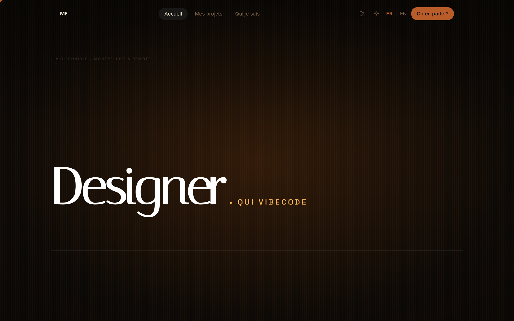

# Portfolio de Margaux Francillard, Product Designer

[▶ gaumsportfolio.vercel.app](https://gaumsportfolio.vercel.app)



Mon portfolio, conçu dans Figma puis codé par mes soins. Il présente mes études de cas produit (Waalaxy, Vela) ainsi que le design system du site lui-même.

## Ce qu'il montre côté code

- **Design system documenté** : page [`/design-system`](https://gaumsportfolio.vercel.app/design-system) qui expose les tokens et les composants utilisés sur le site
- **Bilingue FR/EN** : i18n maison, sans dépendance (`lib/i18n.ts`)
- **Animations** : GSAP, effets de tilt et de survol sur les cartes (`lib/tiltEffect.ts`, `lib/cardHoverAnimation.ts`)
- **Contenu** : une étude de cas par fichier, FR et EN côte à côte, typées (`lib/projects/`)
- **Fiabilité** : lint et typage stricts (`npm run check`), smoke test qui vérifie que chaque page publique répond, projets inclus automatiquement (`npm run smoke`)
- **Travail avec l'IA** : règles projet pour Claude Code dans [`CLAUDE.md`](CLAUDE.md)

## Stack

Next.js 14 (App Router) · TypeScript · Tailwind CSS · GSAP · Vercel

## Lancer en local

```bash
npm install
npm run dev
```
