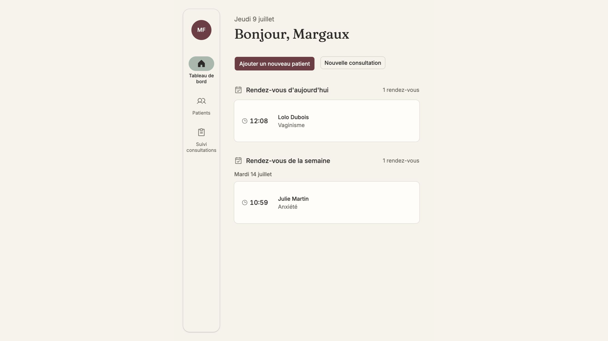

# Portfolio — Margaux Francillard, Product Designer

[▶ gaumsportfolio.vercel.app](https://gaumsportfolio.vercel.app)



Mon portfolio, conçu dans Figma puis codé par mes soins. Il présente mes études de cas produit (Waalaxy, Vela) ainsi que le design system du site lui-même.

## Ce qu'il montre côté code

- **Design system documenté** : page [`/design-system`](https://gaumsportfolio.vercel.app/design-system) qui expose les tokens et les composants utilisés sur le site
- **Bilingue FR/EN** : i18n maison, sans dépendance (`lib/i18n.ts`)
- **Animations** : GSAP, effets de tilt et de survol sur les cartes (`lib/tiltEffect.ts`, `lib/cardHoverAnimation.ts`)
- **Contenu** : études de cas typées (`lib/projects-data.ts`), avec une intégration Notion possible (`lib/notion.ts`)
- **Fiabilité** : smoke test qui vérifie que chaque page publique répond (`npm run smoke`)

## Stack

Next.js 14 (App Router) · TypeScript · Tailwind CSS · GSAP · Vercel

## Lancer en local

```bash
npm install
cp .env.local.example .env.local   # optionnel : clés Notion
npm run dev
```
